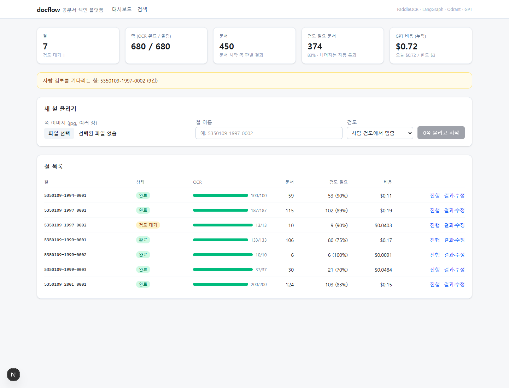
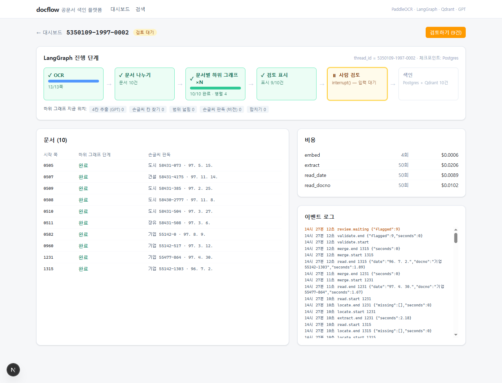
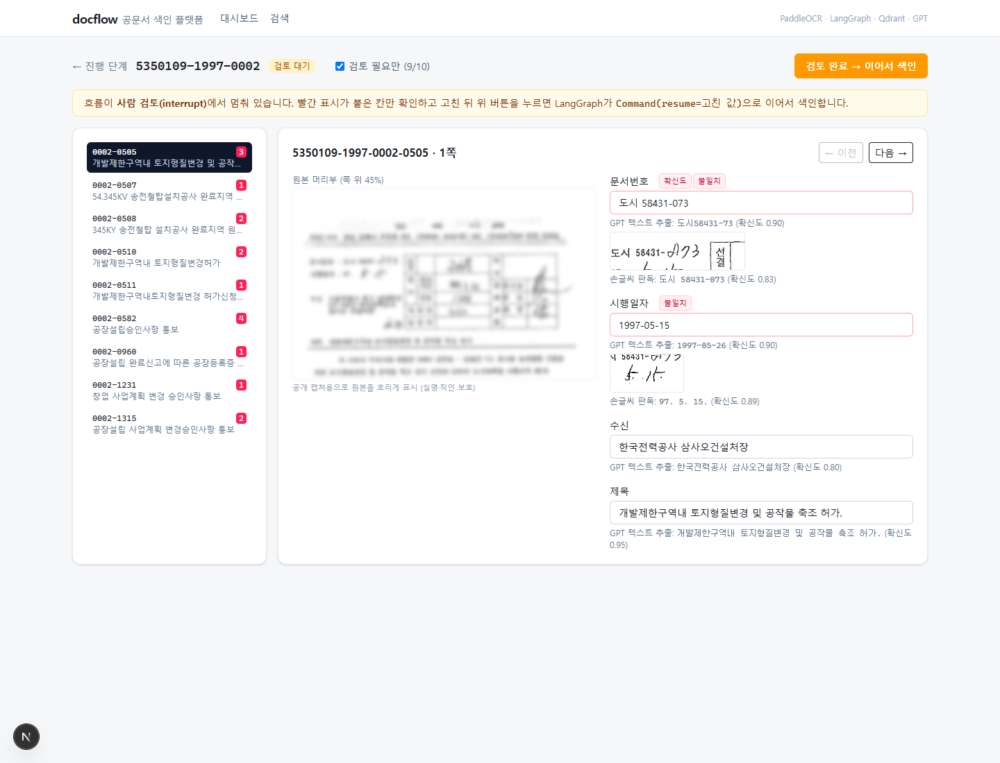
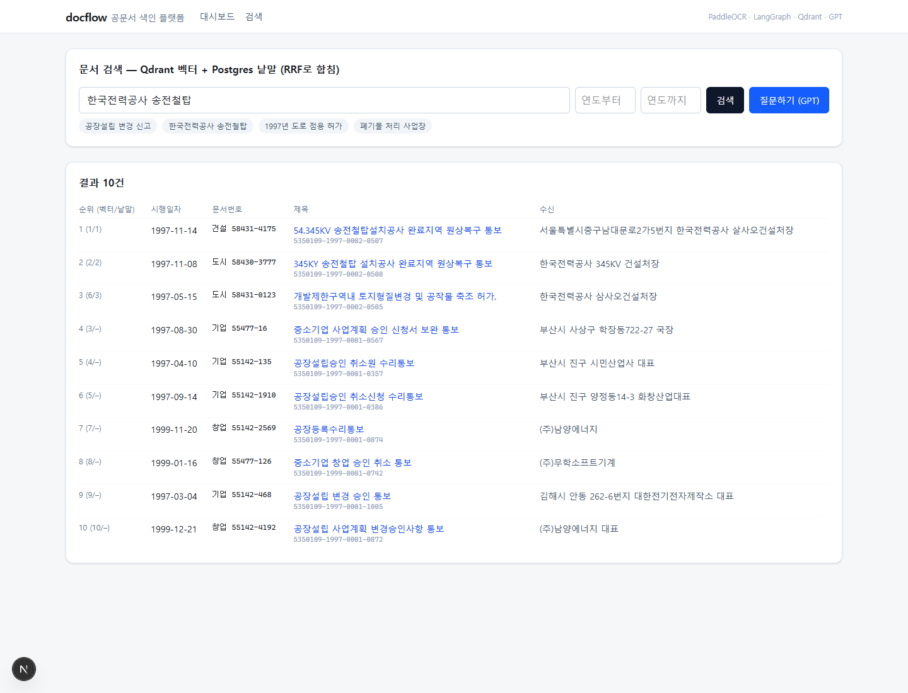
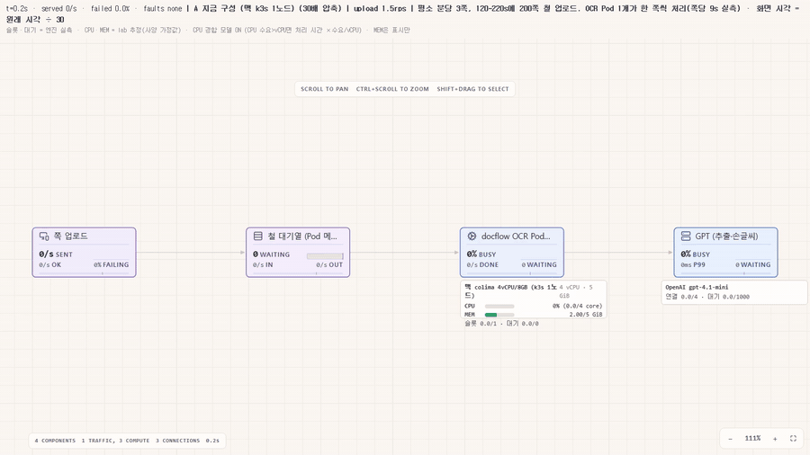
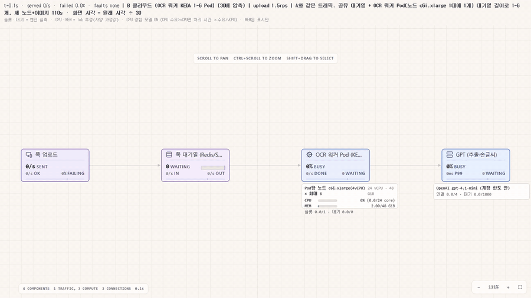

# docflow — 스캔 공문서 색인 플랫폼

1990년대 공문서 스캔 묶음(철)을 올리면 **문서별로 나누고 → 색인 4칸(문서번호·시행일자·수신·제목)을 뽑고 →
자신 없는 칸만 사람에게 넘기고 → 검색**까지 하는 프로토타입입니다.
기록물 디지털화 현장에서 사람이 쪽마다 손으로 치던 색인 입력을 "검토 필요" 표시가 붙은 칸 확인으로 바꾸는 것이 목표입니다.

- OCR: **PaddleOCR**(한국어, CPU, 로컬) + 손글씨 칸만 **GPT 비전**으로 재판독
- 흐름: **LangGraph** — 문서별 병렬 하위 그래프, 칸 위치 재탐색 순환, `interrupt()`로 사람 검토 후 재개, Postgres 체크포인트
- 검색: **Qdrant**(벡터) + Postgres(낱말) → RRF로 합침, 근거 문서를 단 GPT 답변
- 실행: **Kubernetes**(k3s) 위 FastAPI 서비스, 대시보드는 **Next.js**

> 화면 캡처의 원본 쪽 이미지는 실명·직인 보호를 위해 흐리게 처리했습니다. 데이터: AI Hub 「공공행정문서 OCR」 샘플(김해시 인·허가 7개 철 680쪽, 1994~2001).

## 화면

| 대시보드 | 진행 단계 (LangGraph) |
|---|---|
|  |  |

| 결과 검토·수정 | 검색 |
|---|---|
|  |  |

## 구조

```
Next.js 대시보드 ──/api/*──▶ docflow (FastAPI + LangGraph + PaddleOCR)   ── k8s namespace: docs
                                ├─ Postgres  문서 색인 · 비용 장부 · 노드 이벤트 · LangGraph 체크포인트
                                ├─ Qdrant    문서 벡터 (text-embedding-3-small, 연도 필터)
                                └─ OpenAI    4칸 추출 · 손글씨 칸 판독 (gpt-4.1-mini), 임베딩
네트워크: 기본 차단, docflow → Postgres/Qdrant/OpenAI(443)만 허용
```

### LangGraph 흐름

```
철:   ocr → split ─(문서마다 Send, 병렬 4)→ doc ×N → validate ─(검토 필요 & human)→ review [interrupt] → index
                                                           └(없음 또는 auto)────────────────────→ index
문서: extract → locate ─(칸 못 찾음)→ widen → locate …
                      └→ read → merge
```

| 노드 | 하는 일 |
|---|---|
| ocr | 쪽 이미지 → 단어 상자·줄 텍스트. 쪽마다 결과를 저장해 재실행 시 건너뜀 |
| split | 규칙으로 문서 시작 쪽 판별 (머리부 기관명·우편번호 + 문서번호/시행일자) |
| extract | 첫 쪽 텍스트 → GPT가 색인 칸(스키마의 `prompt` 칸, 김해는 4칸) + 확신도. OCR 오독은 문맥으로 교정, 수신은 규칙 보정 |
| locate / widen | 인쇄된 '문서번호'·'시행일자' 옆 손글씨 칸 위치. 못 찾으면 머리부 범위 40→48→56% |
| read | 손글씨 칸 이미지를 GPT 비전으로 판독. 확신도 = 토큰 확률 기하평균(logprobs) |
| validate | 검토 필요 표시: 형식·범위·흐름(같은 철 앞뒤 문서와 비교)·확신도 |
| review | `interrupt()`로 멈춤 → 대시보드에서 고친 값이 `Command(resume=…)`로 들어오면 이어 감 |
| index | Postgres upsert + 임베딩 → Qdrant |

**왜 LangGraph인가:** 사람 검토에서 몇 시간 멈췄다 이어 가야 하고(체크포인트), 문서마다 병렬로 돌리고(Send + reducer),
칸을 못 찾으면 다시 찾는 순환이 있고, 어떤 경로를 지났는지가 남아야 자동 처리율을 잴 수 있기 때문입니다.

### 감사 로그·오류 (https://github.com/reddol18/docflow/issues/28)

| 남는 곳 | 내용 | 원문 값 |
|---|---|---|
| `audit` 표 | 로그인·로그아웃·잠금, 처리 함수 앞에서 거절된 변경 요청, 업로드·실행·이어 가기·검토 저장·문서 수정·작업 시간 보내기마다 시각, 사용자, 행위, 철·문서 id, 결과(`ok` / `rejected_<상태>` / `error`+분류 코드), 개수·칸 이름. 뒤에서 돈 실행의 끝(`run_done`: `ok` / `review_waiting` / `error`)도 시작한 사람으로 | 없음 |
| `edits` 표 | 고친 칸의 이전 값·새 값·사용자 (https://github.com/reddol18/docflow/issues/10) | 있음 |
| `events` 표 (진행 화면) | 노드 시작·끝·오류. 오류는 분류 코드(`budget`·`llm`·`db`·`vector`·`network`·`storage`·`internal`)와 짧은 문구만 | 일부 있음 — 손글씨 판독 값(문서번호·일자), 사용자 이름 |
| 서버 로그 (표준 오류) | 오류 traceback. 키·Bearer/Basic·JWT, 이름이 key·secret·token·password로 끝나는 값, 주소 속 비밀번호는 `***`로 가림 (`app/errors.py`) | 예외 문구에 실명 등이 들어 있으면 남음 |

- **인증 사건** (https://github.com/reddol18/docflow/issues/63): 로그인 성공(`login`/`ok`, 방식 `local`·`oidc`), 실패(`login`/`failed` + 사유 분류), 로그아웃(`logout`/`ok`), 잠금(`lockout`/`locked` — 잠그게 된 실패는 실패 행 대신 이 한 행). 실패 사유: `bad_password`·`unknown_user`·`locked`·`disabled`·`no_password`·`busy`(동시 시도 중)·`csrf`·`rate_limited`, OIDC는 `oidc_error`·`oidc_state`·`oidc_expired`·`oidc_verify`·`oidc_role`. 응답은 지금처럼 늘 같은 문구라 사유는 감사 로그에만 있다.
  - **남기지 않는 것:** 비밀번호, 세션 토큰·쿠키·헤더(해시 포함), 요청 본문, OIDC 코드·토큰·제공자 오류 글, **없는 계정으로 시도한 아이디**(아이디 칸에 비밀번호를 잘못 넣은 것일 수 있다 — 계정 칸을 비우고 `unknown_user`만). 있는 계정이면 그 계정의 id·이름을 남긴다.
  - 세션 없는 로그아웃은 아무 일도 하지 않으므로 남기지 않는다.
  - **시간 차 막기:** 로그인·로그아웃 행과 실패 까닭 분류(없는 계정·잠김·꺼짐을 가르는 조회)는 응답 뒤 감사 쓰기 스레드 하나가 한다(`auth.audit_later`, 차례 유지, 행의 시각은 요청 때). 그래서 **없는 계정·잠긴 계정·꺼진 계정·상한이 찬 때 사이**에는 실패 응답의 요청 스레드 DB 왕복이 같다(자리잡기 UPDATE 한 번). 있는 계정에 틀린 비밀번호를 넣은 경우는 이전부터 시도 횟수 쓰기만큼 다르다 — 계정별 시도 제한(`LOGIN_RATE_USER`)·잠금이 묶는다.
  - 감사 쓰기 스레드는 일·로거가 실패해도 죽지 않고, 죽어 있으면 다음 행이 새로 띄운다. 대기열(10,000)이 차면 버리고 따로 세어 `audit_suppressed`/`queue_full` 행으로 남긴다(서버 로그 한 줄). 앱이 끝날 때(lifespan·atexit) 남은 행을 최대 5초 기다려 쓰고, 못 쓴 개수는 서버 로그에. 로그인 성공 행은 세션을 만든 뒤에 남긴다.
  - CSRF 거절이 많이 쌓일 일은 드물다: 세션 쿠키가 `SameSite=Lax`라 다른 사이트의 POST에는 쿠키가 실리지 않는다(그러면 그냥 401). 로그아웃의 CSRF 거절은 쿠키 사용자를 DB로 찾는데, 그 조회가 DB 오류면 500이 된다.
- **처리 함수 앞에서 거절된 요청:** 로그인 안 함(401)·역할·CSRF(403)·본문 검증(422)도 그 경로의 행위 이름으로 `rejected_<상태>` 한 행 (예: 보기 역할로 업로드 → `upload`/`rejected_403`, 사유 `role`). 대상은 GET이 아닌 경로 전부와 감사 표시가 붙은 GET(`/export.xlsx`·`/export/errors.xlsx`). 사유 분류(`no_session`·`bad_session`·`csrf`·`role`)·메서드·422 오류 개수, 규칙에 맞는 철·문서 id만 — 검증 오류 내용(입력 값이 들어 있다)은 넣지 않는다. 처리 함수 안(`audited()`)에서 난 거절은 거기서 남기므로 다시 남기지 않는다. 422는 GET이 아닌 경로가 처리 함수 앞에서 막힌 것이라 함께 남긴다(로그인한 사람의 잘못된 변경 시도도 흔적이 된다). 깨진 JSON의 422는 로그인 확인보다 먼저 나므로 세션 토큰으로 사용자만 찾아 붙인다(권한 확인 아님). CSRF 거절(로그아웃 포함)은 쿠키 세션의 사용자로 남기되 공격 사이트가 일으키는 것이라 아래 상한 창에 넣는다. 감사 쓰기가 실패해도 원래 401·403·422 응답은 그대로다.
- **표 채우기 막기:** 계정에 묶이지 않는 행(로그인 안 한 요청의 거절, 없는 계정·CSRF·시도 제한에 걸린 로그인 실패, OIDC 실패)은 누구나 무한히 만들 수 있다 → 프로세스마다 `AUDIT_ANON_MAX`행/60초(기본 30)까지만 쓰고, 넘쳐 버린 개수는 다음에 쓸 수 있을 때 `audit_suppressed`/`dropped`(`count`) 한 행으로 남긴다(서버 로그에도 한 줄, 요약을 못 쓰면 개수를 되돌려 다음 요약에). 기본값으로 1년 내내 넘쳐도 약 1,600만 행. 계정에 묶인 행은 계정별 시도 제한·잠금이 이미 묶고, 로그인한 사용자의 거절은 누구인지 남으므로 상한 밖이다.
- **빠짐 막기:** GET이 아닌 경로 함수에는 `@auth.audit_as("행위")`를 붙인다. `tests/test_audit_routes.py`가 `app.routes`(include_router 안까지)를 돌며 표시 없는 변경 경로가 있으면 실패하고, `tests/test_audit_pg.py`가 변경 경로 전부를 로그인 없이 불러 행위 이름별 `rejected_401` 행을 확인한다. 성공 행은 처리 함수의 `audited()`가 남긴다 — 표시된 경로 함수가 같은 행위 이름으로 `audited()`·`audit_event`를 부르는지 `tests/test_audit_routes.py`가 소스(AST)로 확인한다(표시만 붙이고 감사를 빼먹지 못하게).
- 감사 기록 저장이 실패해도 요청은 원래 결과대로 끝나고, 실패는 서버 로그에 남는다.
- **보존:** `audit`은 1년 (2026-11-06 확정). 앱이 시작할 때마다(배포·재시작) 1년 지난 행을 지운다 (`store.prune_audit`).
- **납품 후 삭제 범위:** 쪽 이미지·OCR 결과·색인(`documents`)·벡터·`edits`(원문 값이 있음)·`events`는 지운다. `audit`은 원문 값이 없어 보존 기간까지 남긴다(누가 언제 무엇을 했는지는 납품 뒤에도 확인할 수 있어야 하므로).

### 납품 형식 출력·일괄 삭제 (https://github.com/reddol18/docflow/issues/12)

1. `GET /export/check?vol=…` — 출력 전 검증. 필수 열 빈칸·형식 위반(예: 일부만 읽은 날짜)·검토 안 끝난 건(검토 표시가 있는데 사람 검토 전) 수와 어느 문서·열인지. 스키마에 칸 검증 규칙이 있으면 그 위반(`rule`)도 같은 코드로 센다 (아래 '칸 검증 규칙'). 철을 안 고르면 끝난 철 전부.
2. `GET /export.xlsx?vol=…` (관리자) — 철 목록 시트 + 건 색인 시트. 건은 철 안 쪽 순서(원질서)대로, 철마다 순번 1부터. 글자 칸은 모두 문자열로 써서 `=`로 시작하는 값이 수식이 되지 않는다. `=`·`+`·`-`·`@`·탭·CR로 시작하는 칸은 따옴표 접두(quotePrefix)도 켜서, 받은 사람이 칸을 고치고 Enter를 쳐도 수식이 되지 않는다(값은 그대로).
3. `DELETE /volumes/{vol}?confirm={vol}` (관리자) — 내보낸 철만. 쪽 이미지·OCR·잘라낸 칸(`DATA_DIR`), `documents`·`edits`·`events`·검사 표·검토 단계 표(`doc_stage`·`stage_log`)·LangGraph 체크포인트, Qdrant 벡터를 지운다. `usage`(비용)·`audit`·`review_time`은 값이 없어 남긴다. 지운 개수는 감사 로그(`purge`)에.

양식 열 매핑은 YAML (`app/export_templates/aihub88.yaml`, 바꾸려면 `EXPORT_TEMPLATE=경로`): 열 이름 ↔ 원천(철 이름 조각·쪽 수, 건 순번·쪽, 색인 칸, 고정값) ↔ 형식(`text`·`int`·`year`·`date`+출력 모양). 기본은 AI Hub 88 공개 라벨 기준 예시(철번호·생산기관코드·생산연도 / 문서번호·생산일자 `YYYYMMDD`·수신·제목·시작쪽·끝쪽). 매핑이 틀리면 앱이 시작하지 않는다.

### 색인 칸 스키마 (https://github.com/reddol18/docflow/issues/9)

색인 칸은 코드가 아니라 YAML(`app/field_schemas/`)이 정한다. 쓰는 파일은 `FIELD_SCHEMA=경로`, 없으면 김해 매핑.

- **기본 스키마** `isad_g.yaml` — ISAD(G) 요소(참조코드·제목·일자·기술계층·쪽수·생산부서·내용 요약·보존기간·공개구분·저작권·이용조건·언어·위치·주기 …). 칸마다 ISAD(G) 영역(`area`)이 있다. 그대로 쓰려면 납품 양식(`EXPORT_TEMPLATE`)도 이 칸 이름에 맞춘 것을 줘야 한다 (기본 양식은 김해 칸 이름).
- **기관 매핑** `gimhae.yaml` — 지금 운영 자료(김해 인·허가)의 4칸(문서번호·시행일자·수신·제목)과 숨김 칸 일련번호. 칸마다 `isad:`로 기본 스키마 칸에 잇는다. 추출 지시문(`extract` + 칸별 `prompt`)도 여기 있다 — 바꾸면 점수를 다시 잰다.
- 칸 항목: 이름, 표시명(`label`), 단위(`level`: `document` 건 / `volume` 철), 추출 방식(`method`: `rule` 규칙 · `llm_extract` LLM 추출 · `llm_generate` LLM 문장 생성 · `vocab` 통제어휘 선택 · `fixed` 사업 고정값 · `manual` 사람 입력 · `hidden` 숨김), 표기 규칙(`normalize`). 빠진 항목·모르는 방식·모르는 키가 있으면 앱이 시작하지 않는다.
- 표기 규칙: `date_unknown`(미상 → `9999-99-99`), `decade`(`1950년대` → `1950-00-00 ~ 1959-00-00`), `location`(→ `서고-서가-층-열`), `hanja_hangul`(한자 → 한글 음, Unicode Unihan 표 `hanja_hangul.tsv` — 글자마다 대표 음 하나라 지명·성의 金(김) 같은 예외는 못 가림), `strip`.
- 사업 고정값(`fixed`, 예: 상위계층·저작권·공개구분·이용조건)은 스키마에 한 번 적으면 모든 건에 들어간다. 철 단위 칸은 지금 고정값·사람 입력만 된다.
- 저장: `documents.fields`(jsonb)에 칸 값 전부, 검색용 열 `search_text`(스키마 `search.keyword` 칸)·`year`(`search.year` 칸 앞 네 자리, 미상 제외). 예전 고정 열은 앱이 시작할 때 한 번 옮기고 지운다(`store.migrate_documents`, 한 트랜잭션). 열을 지우면 되돌릴 수 없으므로 이 판을 처음 배포하기 전에 Postgres를 백업한다(`pg_dump`). 이전 이미지로 되돌릴 때는 그 백업을 복원한다 (예전 코드는 새 열 구성을 읽지 못한다).
- 문서 키는 (철, doc_id) (https://github.com/reddol18/docflow/issues/50) — 다른 철에 같은 쪽 파일 이름이 있어도 색인 행·벡터·검색 결과·수정 이력이 철마다 따로 남는다. `documents` 기본 키 `(vol, doc_id)`, Qdrant 점 id = uuid5(`docflow/doc/{vol}/{doc_id}`), `/search`·`/ask` 결과는 `vol`+`doc_id` 쌍. `/ask` 답변 글의 근거 표시는 `[철/doc_id]` (`llm.citations`로 읽고, 검색 평가 `cite_recall`이 `must_cite`와 맞춘다).
  - 예전 판에서 옮기기(다시 처리하지 않음 — 사람이 고친 값·검사·감사 기록을 잃지 않게). ① `store.migrate_doc_key` — `documents` 기본 키를 `doc_id` → `(vol, doc_id)` (한 트랜잭션, 행은 그대로. 카탈로그 한 번 읽기라 시작할 때마다 본다) ② `store.migrate_vectors` — 옛 id(doc_id만)의 Qdrant 점을 payload의 vol·doc_id로 새 id에 벡터·payload 그대로 넣은 뒤 옛 id를 지운다 (임베딩 다시 안 함). payload에 vol·doc_id가 없는 점이 있으면 아무것도 옮기지 않고 시작을 멈춘다 ③ `main.repair_documents` — 색인이 끝난 모든 철(쪽 폴더·`documents`의 철)의 그래프 상태와 `documents` 행을 대조해 없거나 다른 행을 상태대로 다시 쓴다 (칸 값·표시·검토·수정 표시 `edited`. 새로 만드는 행의 `created_at`은 그 철의 첫 색인 시각, 모르면 비워 리포트 '색인 문서 수'에 안 셈). 예전 판에서 한쪽 철을 지운 경우(남은 행에 지운 철 값, 또는 살아 있는 철의 행이 없음)도 잡는다. ②③은 한 번만 — 끝나면 `schema_migrations`에 `doc_key_50`을 남기고 다음 시작부터 훑지 않는다. 중간에 실패하면 표시가 없어 다음 시작에 처음부터 다시(몇 번 돌아도 같은 결과).
  - 이미 덮어쓴 것 (보안 점검 한계): 예전 키로는 같은 쪽 이름의 두 철 중 나중 철의 벡터 하나만 남았다. 먼저 처리한 철의 그 문서는 벡터가 없어 **낱말 검색으로만** 찾힌다. 확인: 옮긴 시작 로그의 `qdrant: 벡터 없는 문서 N개 (철 [...])`. 그 문서의 칸을 고치면(PATCH) 벡터를 다시 만든다.
  - 되돌리기: 예전 이미지는 새 기본 키에서 `ON CONFLICT (doc_id)`가 실패해 색인·수정을 못 한다. 배포 전에 Postgres(`pg_dump`)와 Qdrant 스냅숏을 받아 두고, 되돌릴 때 둘 다 복원한다.
- 사람이 고친 값(검토·수정·검사)에도 같은 표기 규칙을 적용한다.
- 칸 이름이 아니라 `rule` 이름으로 판단한다 (https://github.com/reddol18/docflow/issues/72) — 기관 매핑은 칸 이름을 마음대로 지어도 된다.
  - 손글씨 칸 판독: `rule`이 `docno`·`serial`·`date`인 칸만 잘라 읽는다 (`app/graph.py` `HW_CELLS`). `/schema`가 칸마다 `rule`과 보여 줄 잘라낸 칸(`hw`)을 내보내고, 검토 화면·잘라낸 칸 경로가 그것으로 판단한다.
  - 검토 표시(`app/flags.py`): 김해 규칙(일자·일련번호·수신)은 그 `rule` 칸이 있을 때만 돈다. LLM 확신도 표시는 화면에 보이는 건 단위 LLM 추출 칸(`llm_extract`·`vocab`, 수신 같은 규칙 칸의 LLM 값 포함, 손글씨 규칙 칸·`llm_generate` 요약·숨김·철 단위 칸 제외)마다 붙는다. 표시 키는 칸의 `flag_key`(없으면 칸 이름). 칸 찾기는 `fields.by_rule`·`fields.flag_key`, 규칙이 볼 칸은 `flags.targets(schema)` 한 곳. LLM을 건너뛴 문서(`LLM_PROVIDER=off`)의 추출 칸은 'LLM 꺼짐'만 붙고 'LLM'(낮은 확신도)은 붙지 않는다.
  - 검색 화면 열은 스키마 `search.columns`(없으면 보이는 칸 전부, `/schema`의 `search_columns`). `/search`·`/ask` 결과의 칸 값은 `fields` 아래에 있다.
  - 칸 이름을 바꾼 김해 매핑으로 칸 값·표시가 같은지: `eval/rename_replay.py <저장된 철 JSON…>`. 다른 고객 시험 스키마(지어낸 값)는 `tests/fixtures/schemas/`.
- 철 단위 칸은 고정값·사람 입력만 된다 (철 단위 추출 없음).

#### 칸 검증 규칙 — 기계 검수 (https://github.com/reddol18/docflow/issues/87)

칸마다 `validate:`를 적으면 사람 검토 전에 기계 검수가 돌고, 위반은 그 칸의 검토 표시(`flag_key`)로 붙는다. 규칙 코드는 `app/field_rules.py` 한 곳.

```yaml
- name: rdid                      # 지어낸 예: 고정 길이 식별자 23자리
  label: 도로 식별자
  ...
  validate: {required: true, length: 23, pattern: "[A-Z0-9]{23}", unique: volume}
- name: road_rank                 # 지어낸 예: 도로 종류 코드 4자리
  label: 도로 종류 코드
  method: manual
  ...
  validate: {required: true, length: 4, code_table: codes/road_rank.txt}
```

| 규칙 | 뜻 | 표시 사유 |
|---|---|---|
| `required: true` | 빈칸 금지 | 필수 칸 빈칸 |
| `length: N` | 정확히 N자 | 길이 N자 아님 |
| `max_length: N` | N자까지 | N자 초과 |
| `pattern: "정규식"` | 값 전체가 맞아야 함 (`fullmatch`, 플래그 없음 — `\d`는 유니코드 숫자도 받으니 `[0-9]`로) | 형식(정규식) 불일치 / 형식 검사 길이 초과 |
| `code_table: 경로` | 코드표 파일에 있는 값만 (앞뒤 빈칸은 떼고 비교, 대소문자는 그대로) | 코드표에 없는 값 |
| `unique: volume` | 같은 철 안에서 같은 값 금지 (앞뒤 빈칸은 떼고 비교, 대소문자는 그대로) | 철 안 중복 |

- 표시 사유는 `기계 검수 · 칸 표시명 · 위반 설명` (값은 싣지 않는다). 검토 화면(대시보드·`/review`)의 그 칸 옆에 나온다. 어떤 사유가 기계 검수인지는 서버 상수 머리 `field_rules.PREFIX`(`기계 검수 · `)로 가린다 — 이 머리의 사유는 `field_rules`만 만든다(시험 `test_machine_prefix_only_from_field_rules`). 그래서 스키마 규칙을 빼거나 길이를 바꿔도 예전 사유가 다시 계산 때 지워지고 미검토로 세지지 않는다. `/schema`가 머리(`machine_flag_prefix`)와 칸마다 `validate: {rules, reasons}`를 내려 주고, 대시보드는 그 머리로 색을 달리한다.
- 빈 값에는 `required`만 본다 — 빈칸을 허용하는 칸은 나머지 규칙을 건너뛴다. 규칙은 사람이 고칠 수 있는 칸(`editable` — 숨김·고정값·철 단위 칸 제외)에만 단다 — 고칠 수 없는 칸의 표시는 풀 수 없기 때문.
- 언제 도나: 그래프 `validate` 노드(다른 검토 표시와 함께) → 사람이 값을 고치면 철 전체를 다시 본다(`flags.refresh` — 검토 제출, `PATCH /documents`, 검사, 단계 승인이 모두 같은 `_edit_document`/`review` 길). 다른 표시(확신도·김해 규칙)는 다시 계산하지 않는다(지금과 같음).
- 철 안 중복은 다른 문서 표시도 바꾼다. 문서 수정 때 그 문서는 그대로 저장하고, 표시가 바뀐 다른 문서는 **표시만** 쓴다 — 두 쓰기는 한 트랜잭션(`store.save_edit`)이고, 그래프 상태와 Postgres 쓰기 모두 철 잠금 안에서 해서, 같은 철 다른 문서를 동시에 고친 값을 덮지 않는다. `PATCH` 응답의 `reflagged`가 표시가 바뀐 다른 문서 id이고, 화면은 이것이 있을 때만 목록을 다시 읽는다.
- 표본 검사 목록을 만든 뒤에도 다른 문서 수정으로 문서의 기계 검수 표시가 바뀔 수 있다(의도 — 표시는 지금 값 기준). 검사 목록·이유는 만든 때 그대로다.
- 출력 전 검증(`/export/check`)은 같은 코드(`field_rules.violations`)로 지금 값을 다시 봐 `rule` 문제(칸 `field`·규칙 `rule`·양식 열 `column`·사유)로 센다. 규칙이 있는 스키마일 때만 `rule` 건수 칸이 생긴다. 기계 검수 표시는 값을 고치면 풀리는 것이라 '검토 안 끝난 건'(`not_reviewed`)에는 세지 않는다(같은 위반을 두 번 세지 않게). 출력 기록의 문제 수에 들어가므로 일괄 삭제는 `allow_problems` 규칙을 따른다.
- 규칙이 없는 스키마(김해·ISAD(G) 기본)는 지금과 똑같이 동작한다 (시험: `tests/test_field_rules.py`, `tests/test_schema_customers.py`).
- 코드표 파일: UTF-8 글자 파일, 한 줄에 코드 하나. 코드 뒤에 탭을 두고 설명을 적어도 된다(검사는 코드만). 빈 줄·`#` 줄은 건너뛴다. 경로는 **스키마 파일 폴더 기준 상대 경로**만 — 절대 경로·`..`·링크로 폴더 밖을 가리키면 거부. 1MB까지.
- 앱이 시작하지 않는 경우: 모르는 규칙 키, 값 형식이 틀림, 깨진 정규식, `length` > `max_length`, 코드표 파일 없음·경로 이탈·빈 코드표·같은 코드 두 번, 코드표의 코드가 같은 칸의 길이·정규식과 안 맞음, 고칠 수 없는 칸(숨김·고정값·철 단위)의 규칙.
- 정규식 ReDoS 막기 (Python `re`에는 시간 제한이 없고 새 의존성은 들이지 않는다). 판정은 막는 쪽(fail-closed) — 이 판정이 모르는 구문은 거부한다.
  - 시작할 때 거부: 200자 넘는 패턴; 가변 반복 안의 가변 반복·선택(`(a+)+`, `(a|ab)*`, 원자 그룹 안 `(?>(a+)+b)`도); 고정 횟수 반복 `{n>1}` 안의 가변 반복·선택(`(\w*){30}`, `(a|.){60}`); 글자 집합이 겹치는 가변 요소가 그 집합에 들지 않는 고정 글자 없이 이어지는 것(`a*a*b`, `\w*\w*`, `.*x.*`, `(a|)(a|)`); 역참조·조건 그룹·앞뒤 보기·인라인 플래그.
  - 선택(`|`)은 기본이 가변 요소다. 모든 갈래가 같은 고정 폭이고 빈 갈래가 없으며 어느 자리에서도 갈래끼리 글자가 겹치지 않을 때만 고정으로 본다 — `(시|군|구)`는 고정, `(a|)`·`(a|aa)`·`(a|[^-]|\w)`는 가변.
  - 안전띠: 패턴 전체의 가변 요소(가변 반복 + 가변 선택)는 6개까지, 가변 선택들의 갈래 수 곱은 64까지 — 구분자로 떼어 놓아도 갈래 고르기는 곱으로 늘어난다(`(a|[^-]|\w)-`를 16번).
  - 겹침 판정에서 `\d`·`\w`·`\s`(와 부정)는 ASCII 밖 글자 전체를 포함한다고 넉넉히 본다 — `[가-힣]+\d+`는 거부되니 `[0-9]`로 쓴다.
  - 받는 예: `[A-Z0-9]{23}`, `[A-Z]{2}-[0-9]+`, `\d{4}-\d{2}-\d{2}`, `(\d{2}-){3}\d{2}`, `[가-힣]+(시|군|구)`.
  - 검사할 때는 200자를 넘는 값에 정규식을 돌리지 않고 위반('형식 검사 길이 초과')으로 본다. 받은 패턴의 되짚기는 대략 값 길이에 비례하는 모양만 남지만 증명은 아니다 — 허용 패턴의 200자 최악 입력 시간을 시험으로 잰다(0.1초 안).
- 기관 매핑의 칸은 기본 스키마 칸의 규칙을 물려받지 않는다 — 매핑 칸에 적는다. 시험용 지어낸 예: `tests/fixtures/schemas/road_ledger_rules.yaml` + `codes/road_rank.txt`.
- 범위 밖: 도형·좌표 검수, 확신도 기준값 재조정(https://github.com/reddol18/docflow/issues/8).

### 검토 단계 설정 (https://github.com/reddol18/docflow/issues/86)

검토 흐름(단계 수·이름·맡는 역할·전수/표본·반려 규칙)도 YAML(`app/workflows/`)이 정한다. 쓰는 파일은 `WORKFLOW=경로`, 없으면 `default.yaml` — 지금까지의 입력(reviewer, 철 검토·색인 뒤 수정) → 표본 검사(inspector, `/volumes/{vol}/inspection`) 2단계와 동작·API·화면이 같다. 틀리면 앱이 시작하지 않는다. 항목은 `app/workflow.py` 머리말.

- 예시: `three_stage.yaml`(작업자 → 품질관리자 → 감독관, 감독관은 지금 역할 체계에서 admin), `register_approve.yaml`(가등록 → 승인 → 자료정리 → 등록).
- 단계 승인 `POST /workflow/{vol}/{doc_id}/approve`(고친 칸 함께, 마지막 단계면 확정), 반려 `POST /workflow/{vol}/{doc_id}/reject`(사유 필수) → 그 문서만 `reject_to` 단계로 돌아가고 차례(`round`)가 늘어 다시 올라오면 재검수. 서버가 단계 역할·문서의 지금 단계(건너뛰기·확정 문서)·작업자 ≠ 검수자(`distinct_actors`)를 확인한다. 확인과 쓰기는 문서 잠금(`store.doc_lock`: 프로세스 안 잠금 + Postgres advisory lock) 안에서 한다 — 입력 수정·검사·승인·반려 모두.
- 입력 경로(`PATCH /documents`)로 고칠 수 있는 것은 입력 단계에 있는 문서뿐이다. 예외는 입력 `on_index` 바로 다음이 표본 단계인 흐름(기본 흐름): 검사 전·검사 목록 밖 문서를 지금처럼 고친다. 전수 검수 단계에 있는 문서는 검수자가 승인하며 고치거나 반려로 입력에 돌아와야 고친다. 화면은 `/volumes/{vol}/workflow`의 `editable`로 같은 규칙을 쓴다.
- 문서 상태(`status`): `confirmed` 확정, `excluded` 표본 단계의 검사 목록 밖(검사 제외 — 출력 전 검증에서는 미확정이 아니고 입력 경로로 고칠 수 있다), `pending` 차례 기다림.
- 위치는 `doc_stage`, 승인·반려 기록(사람·단계·차례·사유·고친 칸)은 `stage_log`(`GET /documents/{vol}/{doc_id}/stages`), 감사 로그에는 `stage_approve`·`stage_reject`(단계·이동·차례·재검수 여부, 사유는 길이만). 반려 사유의 제어·방향 제어·폭 0 문자는 지운다. 두 표는 일괄 삭제 대상.
- 철을 처음부터 다시 돌리면(`/run`) 단계 위치를 지우고 실행 세대(`stage_gen`)를 올린다. 작업자 ≠ 검수자와 단계 기록 화면은 지금 세대만 본다(예전 세대 기록은 표에 남는다). 감사 로그 `run`에 지운 위치 수(`stage_reset`).
- `count_unconfirmed: true`면 출력 전 검증(`/export/check`)이 마지막 단계 승인 전 건을 `unconfirmed`로 센다(다른 문제 칸과 같이 경고만 — 출력을 막지 않고, 일괄 삭제는 `allow_problems` 규칙 그대로). 기본 흐름도 센다(사용자 결정 2026-11-09): 확정은 표본 검사를 마친 문서와, 검사 목록이 만들어지고 그 철의 검사가 모두 끝난 뒤의 검사 제외 문서. 검사 목록이 없거나 검사가 남아 있으면 나머지는 미확정.
- 문서 잠금은 `DOC_LOCK_WAIT_SEC`(기본 10초)까지 기다리고, 넘기면 409 "다른 사람이 처리 중". 그래프 상태 읽기→쓰기는 철 잠금 안에서(잠금 순서 문서 → 철).
- 작업자 ≠ 검수자의 입력 판단(철 검토 제출·입력 경로 수정, `store.entered`)은 실행 세대로 거르지 않는다(의도 — 다시 돌리기 전 입력자도 계속 입력자로 보아 넓게 막는다). 단계 승인·반려·검수 수정 기록만 세대로 거른다.
- 예전 판에서 끝나지 않은 검사 차지(`inspection.inspected_at`만 있고 `fixed_fields`가 비어 있음 — 요청이 죽은 경우)는 그대로 두면 그 문서를 검사할 수 없다. 관리자가 확인한 뒤 DB에서 푼다: `UPDATE inspection SET inspected_by = NULL, inspected_at = NULL WHERE vol = '<철>' AND doc_id = '<문서>' AND fixed_fields IS NULL;` (지금 판은 검사를 문서 잠금 안에서 하고 실패하면 차지를 풀어 새로 생기지 않는다)

### 검수 오류목록 (https://github.com/reddol18/docflow/issues/88)

`GET /export/errors.xlsx?vol=…` (관리자) — 철 단위 검수 오류목록 엑셀. 새로 저장하는 것은 없다: 문서의 지금 검토 표시, 수정 이력(`edits`), 단계 승인·반려 기록(`stage_log`), 칸 검증 규칙에서 만든다 (`app/error_list.py`).

- **행 하나 = 실제 오류 하나** (사용자 결정 2026-11-09) — (문서, 칸)마다 모은다. 아래 중 하나면 행이 된다. 이유는 '오류 내용'에 ` / `로, 구분(표시·규칙·반려·검수 수정)은 '오류 구분'에 `·`로 잇는다.

  | | 언제 | 오류 내용 |
  |---|---|---|
  | (가) | 고친 칸인데 그 칸에 검토 표시가 있거나, 처음 고치기 전 값이 칸 검증 규칙을 어겼다 (입력 단계 수정이라도). 철 안 중복은 그 시각 다른 문서 값과 비교 | 표시 사유·기계 검수 사유 |
  | (나) | 검수 단계가 반려한 뒤 다음 단계 기록 전까지 고친 칸. 고친 칸이 없으면 문서 전체 행(칸 `(문서)`, 조치 `재제출`/`미조치`) | `반려 · 단계 표시명: 사유` |
  | (다) | 검수 단계(표본 검사·설정 흐름 검수)에서 고친 칸 | (이유가 없으면) `검수 수정 · 단계 표시명` |
  | (라) | 지금도 남은 기계 검수 위반 — 고치지 않았으면 조치 `미조치` | 그 칸의 표시 사유 |

  확신도 등 검토 표시만 붙고 사람이 고치지 않은 칸은 오류가 아니다(행 없음 — 표시가 많은 철도 행 수가 실제 오류에 가깝게). 표시·규칙 위반·반려가 없는 칸의 입력 단계 수정도 입력 작업이라 넣지 않는다.
- **수정 전후 값·담당자·조치일**: 같은 칸의 수정을 한 행으로 묶는다 — 수정 전 = 첫 수정의 이전 값, 수정 후 = 마지막 수정의 새 값, 담당자·조치일 = 마지막 수정(한국 시간 날짜). 수정이 없는 (라) 행은 수정 전 = 지금 값, 수정 후·담당자·조치일은 빈칸.
- **재검수 판정** = 검수 단계마다(흐름 설정의 입력 다음 단계 순서) 그 문서의 마지막 판정: `단계 표시명: 합격` / `합격 (검수 수정)`(그 단계가 이 칸을 고쳤다 — 지금 세대 수정 이력 기준) / `불합격(반려)`. 그 단계의 판정이 여러 번이면 `(N차)`(그 단계 판정 횟수). `재검수 전`: 승인한 뒤 뒤 단계가 반려해 그 단계나 그 앞으로 되돌아갔거나(예: 등록이 자료정리로 반려), 그 단계가 반려한 문서가 고쳐져 다시 올라왔는데 아직 다시 판정하지 않음. 반려 뒤 아직 다시 올라오지 않았으면 `불합격(반려)`. 흐름에 표본 단계가 없는데 남은 표본 검사 수정은 `검수 수정 · 표본 검사`. 판정이 하나도 없으면 `미판정`(표본 검사 목록 밖이면 `검사 제외`). 뒤 단계가 고치며 승인해도 앞 단계 판정은 그대로다(시각 비교가 아니라 되돌아감으로 판단 — 예전 판 표본 검사 기록처럼 기록 시각이 수정보다 이른 경우도 맞게).
- **지금 실행 세대만**: 철을 처음부터 다시 돌리면(`/run`) 그 전 수정·단계 기록은 빼고 본다 (`stage_gen` — 수정은 세대 시작 시각 뒤, 단계 기록은 `gen`). 그 전 판(https://github.com/reddol18/docflow/issues/86 이전)에 다시 돌린 철은 세대 기록이 없어 예전 수정도 들어간다.
- **규칙 위반은 지금 스키마 규칙 기준**: 고치기 전 값의 위반은 내보낼 때의 스키마 규칙으로 다시 본다(이슈 조건 '새로 저장하지 않음' — 그때의 표시를 따로 저장하지 않는다). 그 사이 규칙을 바꾸면 결과가 달라진다(남은 한계).
- **담당자** — 양식의 `actor`로 고른다. 기본 `masked`(가린 ID): 내보낼 때마다 새로 만든 비밀 키로 사용자 id를 HMAC-SHA256 한 앞 8자리(`담당자-1a2b3c4d`). 키는 응답 뒤 버려 사용자 id·로그인 이름으로 되돌리거나 다른 파일과 잇지 못하고, 한 파일 안에서는 같은 사람이 같은 값이다. `name`: 사용자의 표시 이름(SSO 사용자는 ` (SSO)` — 수정 이력 화면과 같은 구별, `store._USER_COLS`). 표시 이름이 없는 사용자는 로그인 이름 대신 가린 ID.
- **양식**: `app/export_templates/error_list.yaml` (바꾸려면 `ERROR_LIST_TEMPLATE=경로`) — 납품 양식과 같은 열 형식(`name`·`source`·`format`)·같은 검사(`export.parse_sheet`)·같은 엑셀 쓰기(`export.to_xlsx`, 수식 막기 포함). 원천 목록은 그 파일 머리말. 틀리면 앱이 시작하지 않는다.
- **권한·한도·감사**: 관리자만 — 철 전체의 값과 사람·반려 사유가 담긴 반출 파일이라 납품 엑셀과 같은 권한. 색인이 끝난 철만(아니면 409), 철은 200개까지(철을 안 고르면 쪽 폴더의 철 수로 보고, 넘으면 400 — `vol`로 지정), 오류 행은 한 파일 50,000개까지(넘으면 400 — 철을 나눠 받는다), 만들기는 프로세스마다 한 번에 하나(겹치면 409). 감사 로그 `error_list_request`(철 수·행 수·담당자 방식) + 철마다 `error_list`(행 수). 납품 출력 기록(`exports`, 일괄 삭제 근거)에는 넣지 않는다.
- **측정** (이 PC, 지어낸 50,000행, 2026-11-09): 오류 모으기 0.5초, 시트 만들기 + 엑셀 쓰기 12.7초(`to_xlsx`는 쓰기 전용 모드), Python 메모리 최고 약 59MiB(tracemalloc), 파일 2.4MiB.
- 범위 밖: 검토 단계 설정(https://github.com/reddol18/docflow/issues/86), 품질진단 보고서 서식(한글 문서). 남은 한계: 철 안 중복이 다른 문서를 고쳐서 풀린 경우(이 문서는 고치지 않음)는 잡지 않는다. 반려 사유 글 안의 이름은 가리지 않는다. 동시 1건 제한은 프로세스 안에서만(여러 Pod면 Pod마다 하나).

## 측정 결과

7개 철 680쪽 → 문서 450건. 사람이 만든 정답 164건(문서 시작 쪽 86 + 색인 칸)으로 채점 (`eval/score.py`).

| 항목 | docflow | 참고: 이전 PoC |
|---|---|---|
| 문서 시작 판별 recall / precision | **99% / 100%** | 99% / 100% |
| 문서번호 일련번호 (손글씨) | 65% | 81% ¹ |
| 시행일자 (손글씨) | 79% | 87% ¹ |
| 수신 | 46% | 77% |
| 제목 | 88% | 93% |
| 4칸 모두 정답 | 25% | 59% |
| 검토 표시가 붙은 문서 | 80% | 87% |
| **표시 없이 틀린 문서** (사람이 놓치는 것) | **10%** | 1% |

¹ PoC는 같은 데이터로 학습된 손글씨 모델(ko-trocr)이라 높게 나왔을 수 있어 참고만. 데이터 누출이 없는 Claude 비전 기준은 78% / 88%.

- **GPT 비용:** 680쪽 한 번에 약 $0.35 (추출 $0.23, 손글씨 칸 $0.12, 임베딩 $0.003). OCR은 로컬 CPU라 0 — 쪽당 7~11초.
- **모델은 재서 골랐다:** 손글씨 칸 20개로 6가지 설정, 텍스트 추출은 정답 22건으로 4가지를 비교 → 둘 다 gpt-4.1-mini (`docs/design.md` 5절).
- **확신도만으로는 부족했다:** 비전 판독은 틀려도 확신도가 0.9 이상인 경우가 많았다. 텍스트 추출 값과 손글씨 판독 값이 다르면 표시('불일치')하도록 바꿔
  틀린 일련번호의 98%가 검토로 넘어간다.
- **약점 — 수신:** 1990년대 표 양식이라 OCR 줄에 수신 칸과 결재란('국장', '과장')이 섞이고, 텍스트만 보는 GPT가 가려내지 못한다.
  다음 단계는 머리부 이미지를 비전으로 함께 보게 하는 것.

### 모델·지시문 비교 하네스 (https://github.com/reddol18/docflow/issues/22)

모델이나 추출 지시문을 바꿀 때 같은 데이터셋(7개 철 450건)·같은 통과 기준으로 비교한다. promptfoo 0.125.0(`eval/promptfoo/package-lock.json` 고정)으로
후보 × 지시문 판 × 문서 행렬을 돌리고, `eval/promptfoo/gate.py`가 후보 응답으로 철마다 `app/graph.py` merge·validate를 다시 돌려 `eval/score.py` `metrics()`로 채점한다.

```powershell
.\eval\promptfoo\run.ps1                       # gpt-4.1-mini(기준)·gpt-4o-mini × 지시문 current·before_ocr_fix × 7개 철 (1800회, 약 20분·$0.66)
.\eval\promptfoo\run.ps1 -Local -Vols 5350109-1999-0002   # + 로컬 모델(이 PC의 Ollama, 기본 llama3.1:8b). 꺼져 있으면 켜고, 켠 것만 끈다
.\eval\promptfoo\run.ps1 -Local -LocalModel qwen2.5:7b -BaselineFrom ..\work\promptfoo\results_full_20261107.json
                                               # 로컬 모델만 돌리고 기준(gpt-4.1-mini·current) 줄은 지난 결과에서 가져온다 (OpenAI 호출 0, 키 불필요)
.\eval\promptfoo\run.ps1 -Replay               # LLM 호출 없이 저장된 추출 값으로 채점 연결만 확인 (eval/score.py와 같은 숫자)
.\eval\promptfoo\run.ps1 -View                 # 마지막 결과를 promptfoo 비교 화면으로 (http://127.0.0.1:15500)
```

종료 코드: 0 통과, 1 기준을 어긴 후보 있음, 2 입력 문제. 통과 기준은 `eval/promptfoo/criteria.yaml` — 기준 후보(gpt-4.1-mini·current) 대비
표시 없이 틀린 문서 +1.0%p 초과, 칸별 정답률 −3.0%p 초과, 응답 읽기 실패 1건 이상이면 실패.

전체 행렬 결과 (2026-11-07, 7개 철 450건, 정답 164건):

| 후보 | 판 | docno | date | recipient | title | 일련번호 표시 재현율 | 일자 표시 재현율 | 표시 없이 틀림 | 읽기 실패 | 건당 비용 | 평균 지연 | p95 지연 | 판정 |
|---|---|---|---|---|---|---|---|---|---|---|---|---|---|
| gpt-4.1-mini | before_ocr_fix | 63.4% | 78.7% | 46.3% | 87.2% | 98.2% | 54.3% | 1.8% | 0 | $0.00048 | 1.4s | 1.8s | 통과 |
| gpt-4.1-mini | current | 64.0% | 78.7% | 47.0% | 87.2% | 100.0% | 57.1% | 1.8% | 0 | $0.00055 | 1.4s | 1.8s | 기준 |
| gpt-4o-mini | before_ocr_fix | 63.4% | 78.0% | 50.6% | 81.7% | 98.2% | 38.9% | 3.7% | 1 | $0.00020 | 2.5s | 3.2s | 실패: 표시 없이 틀림 +1.9%p, title −5.5%p, 읽기 실패 1 |
| gpt-4o-mini | current | 63.4% | 78.0% | 56.1% | 77.4% | 98.2% | 41.7% | 7.3% | 1 | $0.00023 | 2.5s | 3.5s | 실패: 표시 없이 틀림 +5.5%p, title −9.8%p, 읽기 실패 1 |

- **열:** docno~title = 칸별 최종 정답률(손글씨 판독·검토 표시 규칙까지 거친 값), 표시 재현율 = 틀린 칸 중 검토 표시가 붙은 비율,
  표시 없이 틀림 = 검토 표시 없이 한 칸이라도 틀린 문서 비율, 읽기 실패 = 응답이 JSON으로 안 읽힌 문서 수, 건당 비용 = 토큰 × `app/llm.py` PRICE,
  지연 = promptfoo가 잰 호출 시간(`-Cache`로 다시 쓴 응답은 빼고).
  후보마다 LLM 추출 값만 바꾸고 손글씨 판독 등은 저장 값을 쓴 채 지금 코드의 검토 표시 규칙으로 다시 조립한다.
  위 '측정 결과' 표(표시 없이 틀림 10%)는 그 뒤 바뀐 표시 규칙 전의 저장 결과라 숫자가 다르다.
- **채점 연결 확인:** `-Replay`(저장된 추출 값, LLM 호출 없음)의 점수는 저장된 b·hw를 지금 코드로 다시 조립한 결과(`eval/schema_replay.py` `replay()`, 후보와 같은 길)와 같고,
  `eval/score.py`를 같은 문서에 단독으로 돌린 숫자(docno 64.0%, date 78.7%, recipient 45.7%, title 88.4%, 표시 재현율 100%·57.1%)와도 같다.
- **로컬 모델:** 이 Windows PC의 Ollama만 쓴다(맥은 배포 시험 환경이라 실험에 쓰지 않는다). 띄우기 전에 모델 폴더 드라이브 여유 10GB를 확인한다.
  llama3.1:8b는 작은 철(6건)에서 제목이 기준보다 크게 떨어져 실패, 건당 지연 약 9초·비용 0. 한국어 소형 모델 3개의 전체 450건 측정은
  `docs/design.md` "로컬 텍스트 모델 4칸 추출" (https://github.com/reddol18/docflow/issues/13).
- **기준 다시 쓰기(`-BaselineFrom`, `-Local`과 함께, `-Replay`와는 같이 못 씀):** 로컬 모델만 비교할 때 기준 모델을 다시 부르지 않는다.
  기본 후보 `^local-ollama$`, 판 `^current$`. promptfoo를 부르기 전에 `eval/promptfoo/plan.py`가 promptfoo와 같은 규칙(제공자 id·label에
  대소문자 구분 정규식)으로 걸러질 후보를 세어, 기준(`criteria.yaml` baseline)과 겹치면 멈추고(돈 쓰고 버리는 호출 방지), OpenAI 후보가
  없으면 키를 읽지 않는다. 기준 파일은 `work/promptfoo/` 아래 사본을 `gate.py --baseline-results`에 넘긴다(끝나면 지움).
  `gate.py`는 기준 줄만 이번 결과의 철에 맞춰 가져오고, 기준 모델 id·temperature·response_format·apiBaseUrl이 이번 설정과 다르거나,
  같은 판 후보의 지시문(`prompt.raw`)이 문서마다 기준과 다르거나, 문서 묶음이 다르면 종료 코드 2. `max_tokens` 같은 그 밖의 차이는 gate.md에 경고.
  `gate.md`에는 판정 표 아래 텍스트 추출(B)만 칸별 정답률 표가 붙는다.
- **답변 채점(Ragas·쌍별 승률)은 아직 없다:** `criteria.yaml`의 `answer:` 칸은 자리만 있다 → https://github.com/reddol18/docflow/issues/21.
- **결과·개인정보:** 실제 문서 글자가 담긴 결과(`results.json`, 다시 조립한 문서, promptfoo 결과 DB)는 저장소 밖 `work/promptfoo/`에만 쓴다.
  promptfoo 공유·원격 생성·사용 통계·업데이트 확인은 끈다(`PROMPTFOO_DISABLE_*`, `--no-share`). 단, promptfoo 0.125.0은 사용 통계를 꺼도
  'telemetry disabled' 이벤트 한 번을 r.promptfoo.app으로 보낸다(문서 글자·결과는 없음).
  비교 화면(`-View`)은 `eval/promptfoo/localhost_only.cjs`로 127.0.0.1에만 묶고, Host·Origin이 `127.0.0.1:15500`/`localhost:15500`이 아닌 요청은
  403, 응답의 `Access-Control-Allow-Origin`은 지운다(promptfoo 기본은 모든 인터페이스·모든 출처 허용). 시험(`tests/test_model_harness.py`)은 지어낸 값만 쓴다.
- **키·비용:** OpenAI 키는 Windows 사용자 환경변수에서 읽어 promptfoo를 부르는 동안만 프로세스 환경에 둔다(Ollama·`gate.py`는 물려받지 않음).
  월 한도를 건 이 하네스 전용 OpenAI 프로젝트 키를 권한다. 응답마다 `max_tokens: 512`(정상 응답 최대 310토큰),
  단가(`app/llm.py` PRICE)를 모르는 원격 모델이 섞이면 0원으로 치지 않고 종료 코드 2.
- **로컬 모델 주소:** `run.ps1 -Local`이 켜는 Ollama는 `OLLAMA_HOST=127.0.0.1:11434`로 켠다(이 PC의 Machine 환경변수 `0.0.0.0:11434`를 덮음,
  켠 뒤 듣는 주소를 확인하고 127.0.0.1 밖이면 멈춤). 이미 켜 둔 Ollama는 건드리지 않고, 모든 인터페이스에서 듣고 있으면 경고만 한다.

## 부하 시뮬레이션 (breakscale_wrap)

200쪽짜리 철이 한꺼번에 올라오면 어떻게 되는지를 직접 만든 시뮬레이터 [breakscale_wrap](https://github.com/reddol18/breakscale_wrap)으로 돌렸습니다.
트래픽은 두 구성이 같습니다: 평소 분당 3쪽, 120~220초에 약 200쪽 몰림 (seed 1에서 210쪽).

| A. 지금 구성 — 맥 k3s 1노드, OCR Pod 1개 | B. 클라우드 — 공유 대기열 + OCR 워커 Pod 1~6개 (KEDA) |
|---|---|
|  |  |
| [mp4](docs/media/load_a_mac.mp4) · 영상 130초 = 실제 65분 | [mp4](docs/media/load_b_cloud.mp4) · 영상 40초 = 실제 20분 |

| | A. 맥 1노드 | B. 클라우드 |
|---|---|---|
| OCR 처리 상한 | 분당 6.7쪽 (쪽당 9초 × 1개) | 분당 40쪽 (6개) |
| 대기열 최대 | 약 190쪽 | 약 190쪽 |
| 몰림 끝 → 마지막 쪽 OCR 끝 | **약 56분** | **약 6분** (증설 대기 110초 포함) |
| 실패 | 0 (대기열이 받아 둠) | 0 |
| 몰림 1번에 더 드는 비용 | 0 | 노드 5대 × 약 12.5분 ≈ **$0.20** [가정: c6i.xlarge 서울 온디맨드 약 $0.19/h] |

- **병목은 OCR CPU 하나뿐입니다.** GPT 단계(쪽당 약 2.8초, 동시 4건)는 B에서도 가동률 50% 안팎이라 처리 상한이 분당 약 85쪽입니다. 워커를 12개 넘게 늘리면 그다음은 GPT 동시 호출 수와 계정 분당 한도가 막힙니다.
- **A에서 실패가 없는 이유는 대기열 덕분이지만, 그 대기열이 Pod 메모리에 있습니다.** 56분 사이에 Pod가 재시작되면 대기 중인 쪽이 사라집니다 → [#5](https://github.com/reddol18/docflow/issues/5). B는 이 대기열을 Redis/SQS로 빼는 것이 전제입니다.
- **B로 가려면 바뀌는 것:** 철 단위 실행을 쪽 단위 OCR 작업으로 쪼개 대기열에 넣고, OCR 워커를 API와 분리한 Deployment로 띄워 KEDA가 대기열 길이로 늘립니다.
  LangGraph 그래프는 OCR이 끝난 철부터 이어서 돌립니다(체크포인트는 그대로 Postgres).
- **고정비 어림** [가정, 서울 온디맨드]: EKS 제어부 약 $73/월 + OCR 노드 1대 상시 약 $140/월 + API·DB 노드 약 $76/월 ≈ **월 $290**. GPT는 680쪽에 약 $0.35.

**넣은 값과 출처**

| 값 | 출처 |
|---|---|
| OCR 쪽당 9초, Pod 1개가 한 번에 한 쪽 | [실측] 맥 k3s, 7~11초 |
| GPT 쪽당 2.8초, 동시 4건 | [실측 근사] 추출 2.2초 + 손글씨 판독 1.8초를 문서당 1.45쪽으로 나눔 |
| 몰림 크기·평소 유입량 | [가정] |
| 증설 대기 110초 (KEDA 감지 30초 뒤 시작, 노드 준비 + 2GB 이미지 받기 + 모델 적재) | [가정]. 첫 쪽 15.6초(모델 적재 포함)는 실측 |
| 축소 시점 (대기열이 빈 뒤 5분) | [가정] KEDA 기본 cooldown과 비슷하게 |

**모델의 한계**
- 실제 docflow는 철의 모든 쪽을 OCR한 뒤 문서별 GPT 단계로 넘어갑니다. 시뮬레이션은 쪽 단위 파이프라인으로 근사했습니다. OCR 처리 상한은 같습니다.
- B의 증설·축소 시각은 위 가정으로 계산해 시각표로 넣었습니다. breakscale_wrap의 자체 오토스케일러는 LB가 요청을 밀어 넣는 구조라, 워커가 대기열에서 꺼내 가는 이 구조에는 쓰지 않았습니다.
- 몰림 크기는 도착이 무작위라 seed마다 다릅니다(seed 2에서 약 130쪽). 위 숫자는 seed 1입니다.
- 시나리오: `sim/a_mac.json`, `sim/b_cloud.json` (영상용 30배 압축본 `*_x30.json`, `sim/compress.py`)

## 실행

```bash
# 백엔드 (k8s)
kubectl apply -f k8s/docs.yaml
sh scripts/mac/make_secrets.sh < openai_key      # 키는 표준 입력으로만, 화면에 찍지 않음
sh scripts/mac/build_image.sh                    # PaddleOCR 모델을 이미지에 포함 (2.0GB)
kubectl port-forward -n docs svc/docflow 8000:8000

# 대시보드
cd frontend && npm install && npm run dev        # http://localhost:3000  (DOCFLOW_URL 기본 http://127.0.0.1:8000)
```

컨테이너 최소 권한 (https://github.com/reddol18/docflow/issues/29): 세 컨테이너 모두 root 아님(postgres 70, qdrant·docflow 1000)·읽기 전용 루트 파일시스템·capability 전부 버림·SA 토큰 없음. 쓰는 곳만 PVC·emptyDir(`k8s/docs.yaml` 주석).
- k3s local-path PVC는 hostPath라 `fsGroup`이 듣지 않는다. 데이터 소유자가 다르면 `scripts/mac/deploy.sh`가 apply 전에 멈춘다(`scripts/mac/owner_migrate.sh check`) — 백업 뒤 `owner_migrate.sh qdrant`로 한 번 넘기고 바로 배포.
- emptyDir 상한: qdrant 스냅숏 2Gi(저장소 PVC보다 작지 않게 — PVC를 늘리면 함께, 스냅숏은 만든 뒤 바로 내려받는다. 파드가 다시 뜨면 사라짐), docflow `/tmp` 2Gi(업로드 본문을 Starlette가 흘려 쓰는 곳). 넘으면 kubelet이 docflow 파드를 내쫓으므로 앱이 업로드를 묶는다(`app/upload.py`, https://github.com/reddol18/docflow/issues/26): 파일 하나 `UPLOAD_MAX_MB`(기본 20, 넘으면 413), 요청 하나 `UPLOAD_MAX_FILES`장(기본 50, 넘으면 400), 픽셀 수 `UPLOAD_MAX_MPX`(기본 100MP — A3 600dpi ≈ 70MP, 넘으면 400), 요청 본문 (장 수 × 파일 상한 + 1MB, 처리 함수보다 먼저 413), 동시에 받는 본문 합계 `UPLOAD_TMP_MB`(기본 1536, 넘으면 429). 같은 이름의 다른 내용은 409, `?replace=true`면 바꾸고 그 쪽 OCR을 지운다(처음·끝난 철만, 끝난 철은 `/run`으로 다시).

## 개발 절차

- 로컬 검사: `.\scripts\check.ps1` — 끝에 나오는 요약을 PR '테스트' 칸에 붙인다 (클라우드 CI 없음).
- 파이썬 의존성: 이미지는 `requirements.lock`(전이 의존성까지 판·해시 고정)으로 `pip install --require-hashes --no-deps --only-binary :all:` 설치한다 — 같은 커밋이면 몇 번 빌드해도 같은 패키지 (https://github.com/reddol18/docflow/issues/33).
  `requirements.txt`를 바꿨을 때만 `.\scripts\lock_refresh.ps1`로 lock을 다시 만든다(맥 컨테이너에서 linux/amd64로 풀어 freeze 파일만 꺼내고 — 이미지 태그 없음 — `scripts/lock_hashes.py`가 PyPI 휠 해시를 붙임, 배포 없음) → 바뀐 판을 확인하고 함께 커밋. 안 맞으면 로컬 검사 `lock` 단계가 막는다.
- **병합은 `scripts/merge.ps1`로만** 한다 (https://github.com/reddol18/docflow/issues/83). `.\scripts\merge.ps1 <PR> -DryRun`으로 먼저 확인한다.
  PR head 커밋의 로컬 검사 요약(막는 검사 모두 통과, 건너뜀 거부)·계약 리뷰·버그 리뷰 결과 댓글(댓글·리뷰 한 글 안에 이름과
  '| 지적 | 반영 |' 표)·보안 영향 칸에 체크가 있으면 보안 리뷰 결과 댓글이 있어야, 확인한 head 그대로 squash 병합(제목 끝 `(#N)`)한다.
  `docs/`·README·잠금 파일만 바꾼 PR은(`requirements*.txt`·`requirements.lock`은 이미지 입력이라 코드로 봄) 리뷰 흔적을 요구하지 않고 osv·semgrep·trivy 건너뜀(`-Quick`)을 허용한다.
  실제 병합은 사용자 승인 뒤에만. 판정은 `scripts/merge_gate.py`가 하고, 흔적 찾기·코드 없음·보안 영향 함수는 주간 지표
  `scripts/weekly_metrics.py`와 공유한다. 주간 지표는 흔적이 있는지만 세고, 병합 검사가 더 엄격하다(head 기준, 표 필요, 건너뜀 거부, 리뷰는 PR 본문 제외).
- **GitHub 쪽 강제 — commit status + main ruleset** (https://github.com/reddol18/docflow/issues/85, 클라우드 CI 없음).
  main ruleset("Protect Main")이 PR head 커밋에 아래 두 status가 모두 success여야 병합을 허락한다 — 웹 화면·`gh pr merge`도 같다.

  | status | 올리는 것 | 올리는 조건 |
  |---|---|---|
  | `docflow/local-check` | `scripts/check.ps1` 끝 (`scripts/gate_status.py`) | 막는 검사(`merge_gate.CHECKS`) 모두 통과, 건너뜀 없음(코드 없는 PR만 osv·semgrep·trivy 허용, `-Skip pg`도 건너뜀), 시작·끝 모두 커밋 안 된 변경 없음(`git status` 실패도 변경으로 봄), 검사 중 HEAD 그대로, HEAD가 push돼 있음. 아니면 아무것도 올리지 않는다 |
  | `docflow/review-gate` | `scripts/merge.ps1`의 실제 병합 호출(묻고 y 또는 `-Yes`, 즉 사용자 승인 뒤) | 위 병합 판정 통과 + 열린 PR일 때 병합 직전에 success. `-DryRun`·처음 판정·취소에서는 올리지 않는다. 판정이 거부인데 전의 success가 있으면 failure로 덮는다 |

  병합 판정은 저장소 주인·멤버·협업자(authorAssociation)의 글만 흔적으로 세고(공개 저장소), head의 `docflow/local-check` success도 확인한다.
  그래서 순서는: 커밋 → **push** → `.\scripts\check.ps1`(끝에 'commit status: 올림/올리지 않음/올리기 실패'를 보인다, 요약을 PR에 붙임) → 리뷰 댓글 → `.\scripts\merge.ps1 <PR>`.
  status는 커밋에 붙으므로 push로 head가 바뀌면 둘 다 다시 받아야 한다. push 전에 돌린 검사는 status를 못 올리니 push 뒤 다시 돌린다. 배포(`scripts/deploy.ps1`)의 검사는 `-NoStatus`.
  확인: `gh api repos/reddol18/docflow/commits/<sha>/status --jq '.statuses[] | [.context,.state,.description] | @tsv'`.
  규칙 설정은 `scripts/protect_main.ps1`(→ `scripts/gate_ruleset.py`; 먼저 `-DryRun`, 저장소 설정을 바꾸므로 사용자 승인 뒤에만): classic branch protection이 아니라
  기존 ruleset에 required_status_checks 규칙(위 둘, strict 끔 — 켜면 main이 바뀔 때마다 다시 올리고 로컬 검사를 다시 돌려야 함, `-Strict`)을 더한다. 다른 규칙(PR 필수·삭제·force push 금지)은 그대로.
  ruleset에 우회 주체가 없으므로 저장소 주인도 우회 못 한다(classic의 enforce_admins와 같음).
  비상 해제(status 올리기가 고장 나 다 막힘): `.\scripts\protect_main.ps1 -AllowAdminBypass`(관리자만 우회) 또는 `-RemoveStatusRule`(status 규칙만 뺌). 고친 뒤 인자 없이 다시 돌린다.
  남은 한계: 쓰기 권한 토큰이면 누구나 status를 올릴 수 있다(올린 앱을 고정하지 않음 — 고정하려면 GitHub App 필요). strict를 끄므로 오래된 base 위에서 통과한 PR도 병합될 수 있다.

## 폴더

| | |
|---|---|
| `app/` | FastAPI · LangGraph 흐름(`graph.py`) · OCR · 규칙(`layout.py`) · GPT 호출(`llm.py`) · 저장소 |
| `frontend/` | Next.js 16 대시보드 (업로드 · 진행 단계 · 검토 에디터 · 검색) |
| `k8s/` | 네임스페이스 · 네트워크 정책 · Postgres · Qdrant · docflow |
| `eval/` | 정답 채점(`score.py`), 모델·지시문 비교 하네스(`promptfoo/`, 예전 일회성 `cell_variants.py`, `extract_variants.py`). 정답 데이터와 채점 규칙은 이전 PoC 폴더에 있어 이 레포만으로는 돌지 않음 |
| `sim/` | breakscale_wrap 부하 시나리오 (지금 구성 / 클라우드)와 실행기 |
| `docs/` | 설계(`design.md`), 실습 기록(`lab_log.md`), 화면 캡처·시뮬레이션 영상 |
