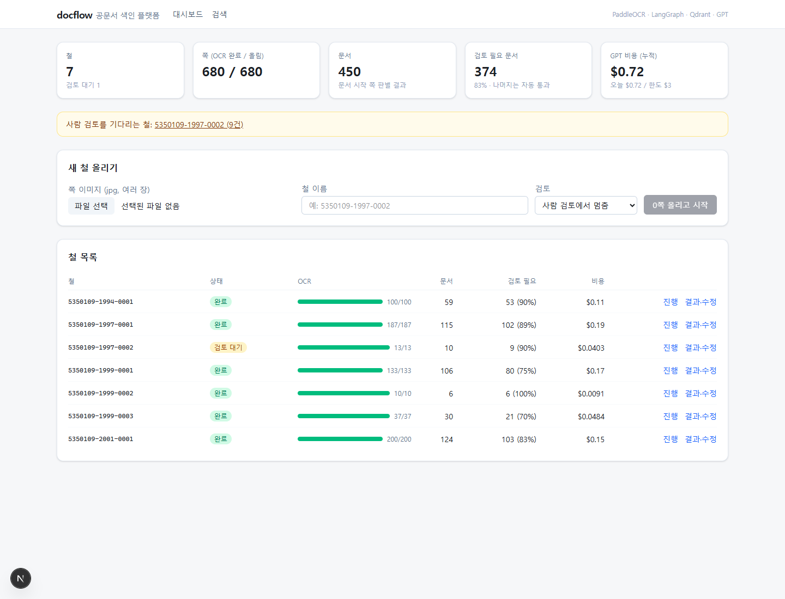
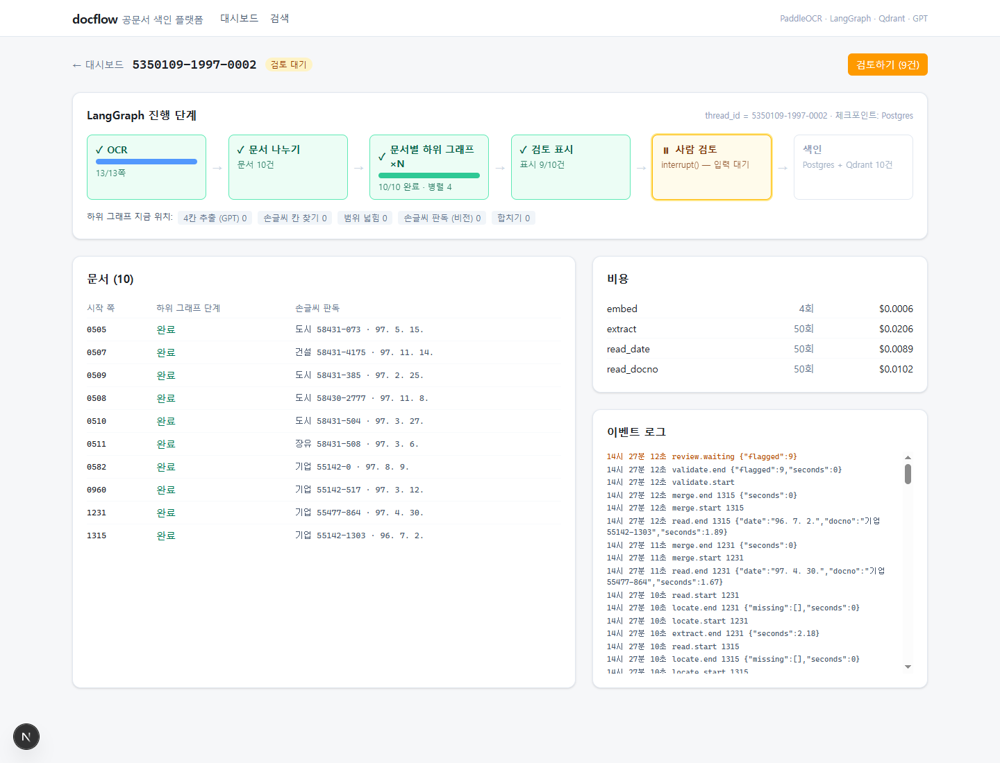
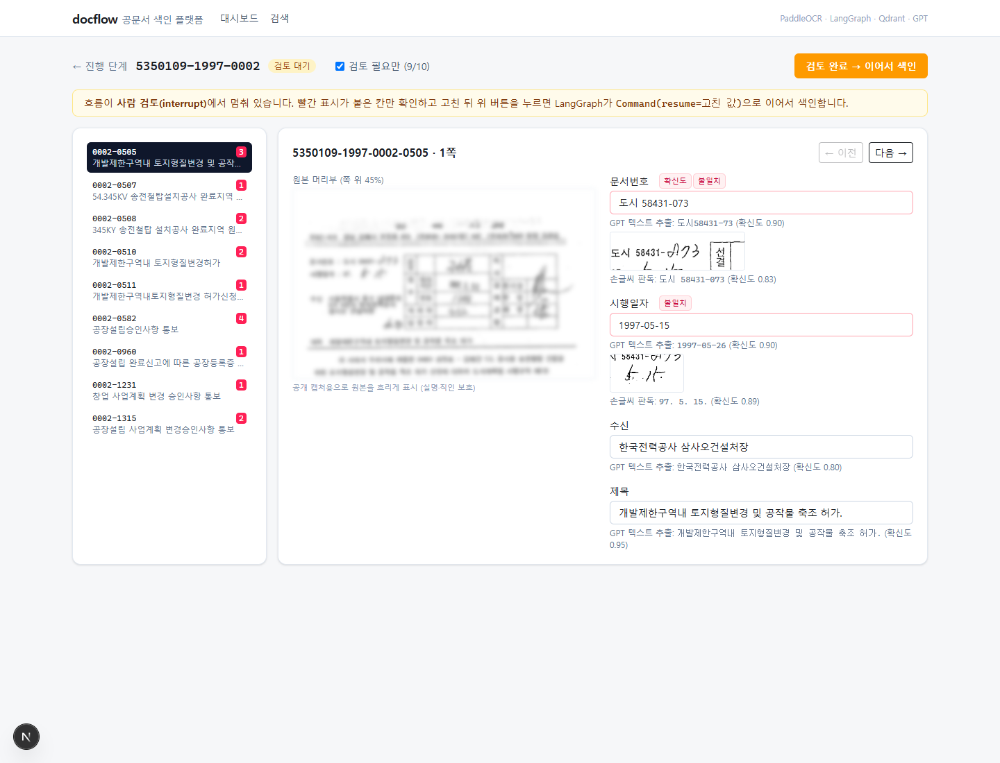
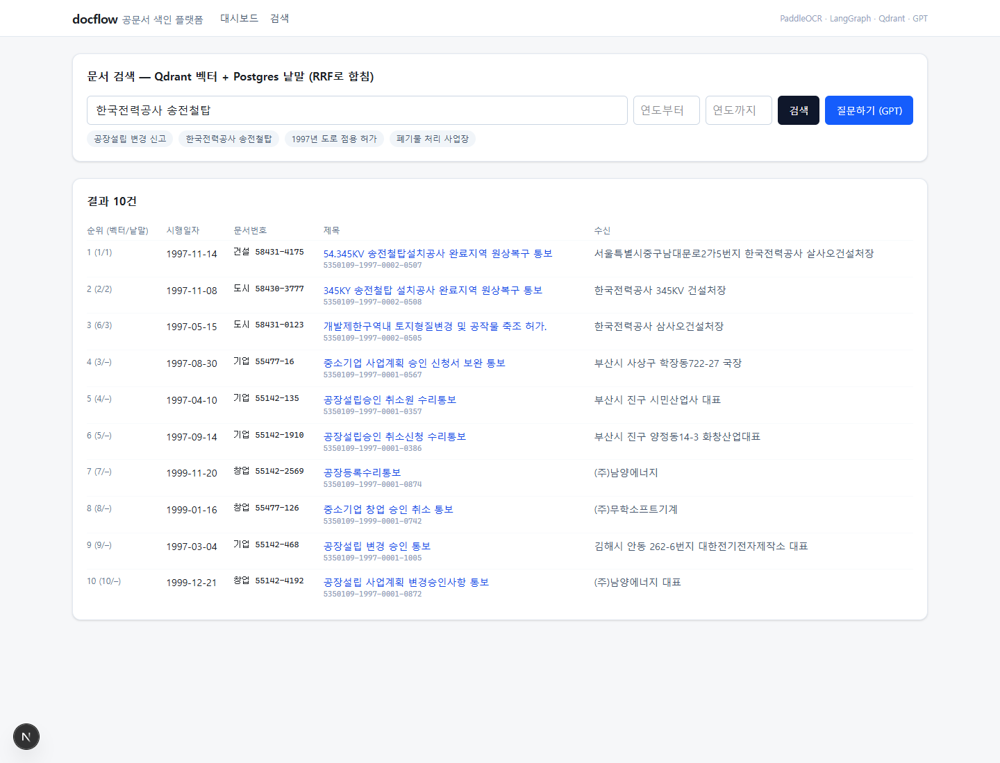
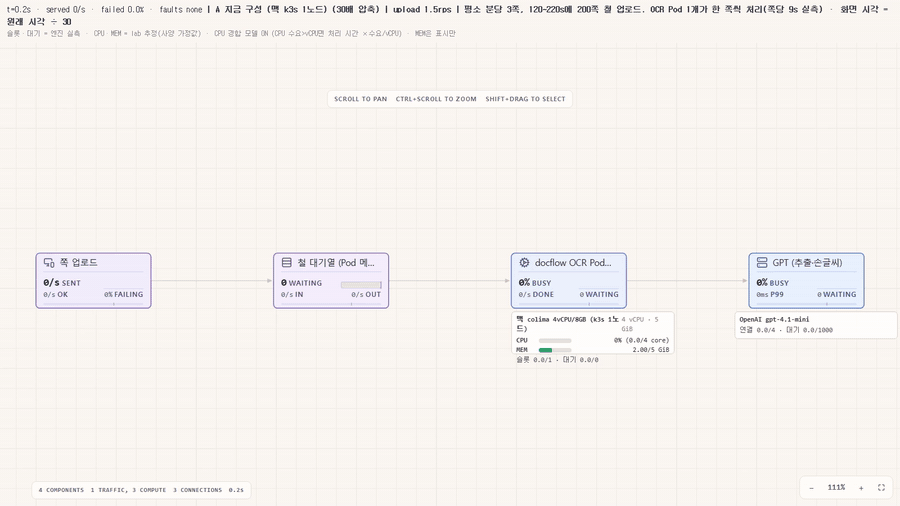
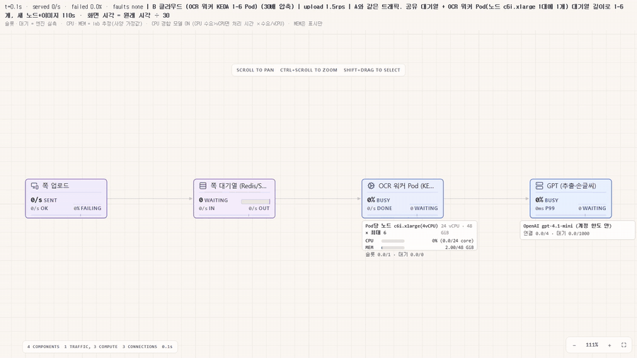

# docflow — 스캔 공문서 색인 플랫폼

1990년대 공문서 스캔 묶음(철)을 올리면 **문서별로 나누고 → 색인 4칸(문서번호·시행일자·수신·제목)을 뽑고 →
자신 없는 칸만 사람에게 넘기고 → 검색**까지 하는 프로토타입입니다.
기록물 디지털화 현장에서 사람이 쪽마다 손으로 치던 색인 입력을 "검토 필요" 표시가 붙은 칸 확인으로 바꾸는 것이 목표입니다.

- OCR: **PaddleOCR**(한국어, CPU, 로컬) + 손글씨 칸만 **GPT 비전**으로 재판독
- 흐름: **LangGraph** — 문서별 병렬 하위 그래프, 칸 위치 재탐색 순환, `interrupt()`로 사람 검토 후 재개, Postgres 체크포인트
- 검색: **Qdrant**(벡터) + Postgres(낱말) → RRF로 합침, 근거 문서를 단 GPT 답변
- 실행: **Kubernetes**(k3s) 위 FastAPI 서비스, 대시보드는 **Next.js**

> 화면 캡처의 원본 쪽 이미지는 실명·직인 보호를 위해 흐리게 처리했습니다. 데이터: AI Hub 「공공행정문서 OCR」 샘플(김해시 인·허가 7개 철 680쪽, 1994~2001).

## 화면

| 대시보드 | 진행 단계 (LangGraph) |
|---|---|
|  |  |

| 결과 검토·수정 | 검색 |
|---|---|
|  |  |

## 구조

```
Next.js 대시보드 ──/api/*──▶ docflow (FastAPI + LangGraph + PaddleOCR)   ── k8s namespace: docs
                                ├─ Postgres  문서 색인 · 비용 장부 · 노드 이벤트 · LangGraph 체크포인트
                                ├─ Qdrant    문서 벡터 (text-embedding-3-small, 연도 필터)
                                └─ OpenAI    4칸 추출 · 손글씨 칸 판독 (gpt-4.1-mini), 임베딩
네트워크: 기본 차단, docflow → Postgres/Qdrant/OpenAI(443)만 허용
```

### LangGraph 흐름

```
철:   ocr → split ─(문서마다 Send, 병렬 4)→ doc ×N → validate ─(검토 필요 & human)→ review [interrupt] → index
                                                           └(없음 또는 auto)────────────────────→ index
문서: extract → locate ─(칸 못 찾음)→ widen → locate …
                      └→ read → merge
```

| 노드 | 하는 일 |
|---|---|
| ocr | 쪽 이미지 → 단어 상자·줄 텍스트. 쪽마다 결과를 저장해 재실행 시 건너뜀 |
| split | 규칙으로 문서 시작 쪽 판별 (머리부 기관명·우편번호 + 문서번호/시행일자) |
| extract | 첫 쪽 텍스트 → GPT가 4칸 + 확신도. OCR 오독은 문맥으로 교정, 수신은 규칙 보정 |
| locate / widen | 인쇄된 '문서번호'·'시행일자' 옆 손글씨 칸 위치. 못 찾으면 머리부 범위 40→48→56% |
| read | 손글씨 칸 이미지를 GPT 비전으로 판독. 확신도 = 토큰 확률 기하평균(logprobs) |
| validate | 검토 필요 표시: 형식·범위·흐름(같은 철 앞뒤 문서와 비교)·확신도 |
| review | `interrupt()`로 멈춤 → 대시보드에서 고친 값이 `Command(resume=…)`로 들어오면 이어 감 |
| index | Postgres upsert + 임베딩 → Qdrant |

**왜 LangGraph인가:** 사람 검토에서 몇 시간 멈췄다 이어 가야 하고(체크포인트), 문서마다 병렬로 돌리고(Send + reducer),
칸을 못 찾으면 다시 찾는 순환이 있고, 어떤 경로를 지났는지가 남아야 자동 처리율을 잴 수 있기 때문입니다.

## 측정 결과

7개 철 680쪽 → 문서 450건. 사람이 만든 정답 164건(문서 시작 쪽 86 + 색인 칸)으로 채점 (`eval/score.py`).

| 항목 | docflow | 참고: 이전 PoC |
|---|---|---|
| 문서 시작 판별 recall / precision | **99% / 100%** | 99% / 100% |
| 문서번호 일련번호 (손글씨) | 65% | 81% ¹ |
| 시행일자 (손글씨) | 79% | 87% ¹ |
| 수신 | 46% | 77% |
| 제목 | 88% | 93% |
| 4칸 모두 정답 | 25% | 59% |
| 검토 표시가 붙은 문서 | 80% | 87% |
| **표시 없이 틀린 문서** (사람이 놓치는 것) | **10%** | 1% |

¹ PoC는 같은 데이터로 학습된 손글씨 모델(ko-trocr)이라 높게 나왔을 수 있어 참고만. 데이터 누출이 없는 Claude 비전 기준은 78% / 88%.

- **GPT 비용:** 680쪽 한 번에 약 $0.35 (추출 $0.23, 손글씨 칸 $0.12, 임베딩 $0.003). OCR은 로컬 CPU라 0 — 쪽당 7~11초.
- **모델은 재서 골랐다:** 손글씨 칸 20개로 6가지 설정, 텍스트 추출은 정답 22건으로 4가지를 비교 → 둘 다 gpt-4.1-mini (`docs/design.md` 5절).
- **확신도만으로는 부족했다:** 비전 판독은 틀려도 확신도가 0.9 이상인 경우가 많았다. 텍스트 추출 값과 손글씨 판독 값이 다르면 표시('불일치')하도록 바꿔
  틀린 일련번호의 98%가 검토로 넘어간다.
- **약점 — 수신:** 1990년대 표 양식이라 OCR 줄에 수신 칸과 결재란('국장', '과장')이 섞이고, 텍스트만 보는 GPT가 가려내지 못한다.
  다음 단계는 머리부 이미지를 비전으로 함께 보게 하는 것.

## 부하 시뮬레이션 (breakscale_wrap)

200쪽짜리 철이 한꺼번에 올라오면 어떻게 되는지를 직접 만든 시뮬레이터 [breakscale_wrap](https://github.com/reddol18/breakscale_wrap)으로 돌렸습니다.
트래픽은 두 구성이 같습니다: 평소 분당 3쪽, 120~220초에 약 200쪽 몰림 (seed 1에서 210쪽).

| A. 지금 구성 — 맥 k3s 1노드, OCR Pod 1개 | B. 클라우드 — 공유 대기열 + OCR 워커 Pod 1~6개 (KEDA) |
|---|---|
|  |  |
| [mp4](docs/media/load_a_mac.mp4) · 영상 130초 = 실제 65분 | [mp4](docs/media/load_b_cloud.mp4) · 영상 40초 = 실제 20분 |

| | A. 맥 1노드 | B. 클라우드 |
|---|---|---|
| OCR 처리 상한 | 분당 6.7쪽 (쪽당 9초 × 1개) | 분당 40쪽 (6개) |
| 대기열 최대 | 약 190쪽 | 약 190쪽 |
| 몰림 끝 → 마지막 쪽 OCR 끝 | **약 56분** | **약 6분** (증설 대기 110초 포함) |
| 실패 | 0 (대기열이 받아 둠) | 0 |
| 몰림 1번에 더 드는 비용 | 0 | 노드 5대 × 약 12.5분 ≈ **$0.20** [가정: c6i.xlarge 서울 온디맨드 약 $0.19/h] |

- **병목은 OCR CPU 하나뿐입니다.** GPT 단계(쪽당 약 2.8초, 동시 4건)는 B에서도 가동률 50% 안팎이라 처리 상한이 분당 약 85쪽입니다. 워커를 12개 넘게 늘리면 그다음은 GPT 동시 호출 수와 계정 분당 한도가 막힙니다.
- **A에서 실패가 없는 이유는 대기열 덕분이지만, 그 대기열이 Pod 메모리에 있습니다.** 56분 사이에 Pod가 재시작되면 대기 중인 쪽이 사라집니다 → [#5](https://github.com/reddol18/docflow/issues/5). B는 이 대기열을 Redis/SQS로 빼는 것이 전제입니다.
- **B로 가려면 바뀌는 것:** 철 단위 실행을 쪽 단위 OCR 작업으로 쪼개 대기열에 넣고, OCR 워커를 API와 분리한 Deployment로 띄워 KEDA가 대기열 길이로 늘립니다.
  LangGraph 그래프는 OCR이 끝난 철부터 이어서 돌립니다(체크포인트는 그대로 Postgres).
- **고정비 어림** [가정, 서울 온디맨드]: EKS 제어부 약 $73/월 + OCR 노드 1대 상시 약 $140/월 + API·DB 노드 약 $76/월 ≈ **월 $290**. GPT는 680쪽에 약 $0.35.

**넣은 값과 출처**

| 값 | 출처 |
|---|---|
| OCR 쪽당 9초, Pod 1개가 한 번에 한 쪽 | [실측] 맥 k3s, 7~11초 |
| GPT 쪽당 2.8초, 동시 4건 | [실측 근사] 추출 2.2초 + 손글씨 판독 1.8초를 문서당 1.45쪽으로 나눔 |
| 몰림 크기·평소 유입량 | [가정] |
| 증설 대기 110초 (KEDA 감지 30초 뒤 시작, 노드 준비 + 2GB 이미지 받기 + 모델 적재) | [가정]. 첫 쪽 15.6초(모델 적재 포함)는 실측 |
| 축소 시점 (대기열이 빈 뒤 5분) | [가정] KEDA 기본 cooldown과 비슷하게 |

**모델의 한계**
- 실제 docflow는 철의 모든 쪽을 OCR한 뒤 문서별 GPT 단계로 넘어갑니다. 시뮬레이션은 쪽 단위 파이프라인으로 근사했습니다. OCR 처리 상한은 같습니다.
- B의 증설·축소 시각은 위 가정으로 계산해 시각표로 넣었습니다. breakscale_wrap의 자체 오토스케일러는 LB가 요청을 밀어 넣는 구조라, 워커가 대기열에서 꺼내 가는 이 구조에는 쓰지 않았습니다.
- 몰림 크기는 도착이 무작위라 seed마다 다릅니다(seed 2에서 약 130쪽). 위 숫자는 seed 1입니다.
- 시나리오: `sim/a_mac.json`, `sim/b_cloud.json` (영상용 30배 압축본 `*_x30.json`, `sim/compress.py`)

## 실행

```bash
# 백엔드 (k8s)
kubectl apply -f k8s/docs.yaml
sh scripts/mac/make_secrets.sh < openai_key      # 키는 표준 입력으로만, 화면에 찍지 않음
sh scripts/mac/build_image.sh                    # PaddleOCR 모델을 이미지에 포함 (2.0GB)
kubectl port-forward -n docs svc/docflow 8000:8000

# 대시보드
cd frontend && npm install && npm run dev        # http://localhost:3000  (DOCFLOW_URL 기본 http://127.0.0.1:8000)
```

## 폴더

| | |
|---|---|
| `app/` | FastAPI · LangGraph 흐름(`graph.py`) · OCR · 규칙(`layout.py`) · GPT 호출(`llm.py`) · 저장소 |
| `frontend/` | Next.js 16 대시보드 (업로드 · 진행 단계 · 검토 에디터 · 검색) |
| `k8s/` | 네임스페이스 · 네트워크 정책 · Postgres · Qdrant · docflow |
| `eval/` | 정답 채점(`score.py`), 모델·지시문 비교(`cell_variants.py`, `extract_variants.py`). 정답 데이터와 채점 규칙은 이전 PoC 폴더에 있어 이 레포만으로는 돌지 않음 |
| `sim/` | breakscale_wrap 부하 시나리오 (지금 구성 / 클라우드)와 실행기 |
| `docs/` | 설계(`design.md`), 실습 기록(`lab_log.md`), 화면 캡처·시뮬레이션 영상 |
